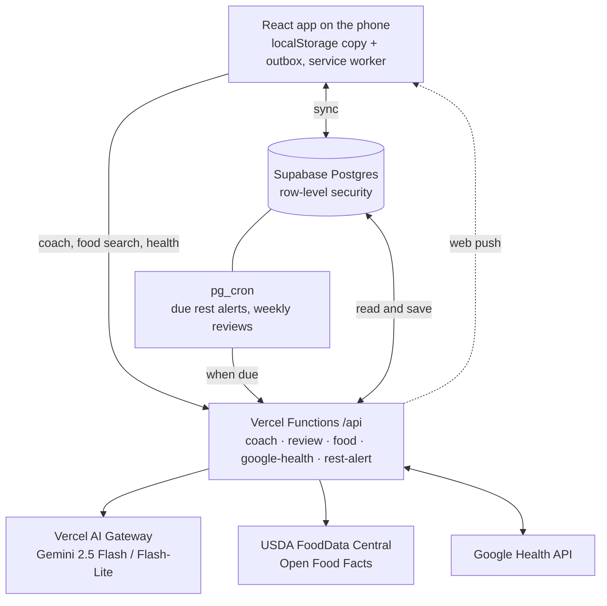

# GymBuddy

A training and nutrition log for your phone, with a crew of six cartoon coaches who actually read
your data. Log a workout and the coach for that lift tells you what the next set should be. Describe
lunch in plain English and it's itemized into macros. Every Sunday the crew writes up your week.

GymBuddy is a React web app you add to your home screen, backed by Supabase and a handful of Vercel
Functions. It started as a single-file Claude artifact for one lifter's 4-day split and grew, PR by
PR, into what's here. 

## What it does

**Training**

- **Logging that stays out of the way.** Each set is pre-filled from last time, one tap logs it, and
  everything autosaves to the phone first, so dead gym wifi never loses a workout.
- **A coach between every set.** After each set, the lift's coach says what to do next: more reps,
  more weight, or bank a quality set on an off day. It runs on the phone from double-progression
  rules and your own history (how much your reps usually drop set to set, today's form against your
  best), so it's instant and free.
- **Fatigue-aware progress.** A lift done after other work for the same muscle is compared against a
  "fresh-equivalent" max, so doing it later in the workout doesn't read as getting weaker.
- **Machine busy?** One tap reshuffles the day: a lift for a different muscle now, or a swap that
  trains the same muscle the same way.
- **Rest timer with lock-screen alerts.** A push notification when rest ends, even with the phone
  locked (home screen app on iOS 16.4+).
- **Your program, your way.** A default 4-day Push / Pull / Legs / Shoulders & Arms split, up to 7
  days, cardio warm-ups and finishers, a ~60-lift library, and paste-in import for a program you
  already run. A rep-range check flags ranges that don't suit the lift.

**The coaches**

- **Six coaches, one per area:** Tank (chest & triceps), Wings (back & biceps), Boulder (shoulders),
  Piston (legs), Brick (core) and Dash (cardio). Each is drawn in SVG with their own idle animation,
  hello and voice.
- **A head coach you talk to.** Picked at sign-up, they run setup (goals, bodyweight, training days),
  set your nutrition targets, and hold one ongoing conversation with a memory of what matters (an
  injury, your equipment). Every answer sees your last 30 days of training and food in full, plus
  your whole history summarized further back.
- **Changes on a card, never behind your back.** Coaches can propose program changes or fixes to your
  food log, but nothing changes until you tap Apply, and Undo takes it back.
- **Workout walkthroughs.** On any workout's recap, the head coach walks you through it step by step
  (what went well, what to improve, what to do next time), scrolling to and outlining each part of
  the recap as it goes.

**Nutrition** (optional)

- **One box for everything.** Search your foods (ranked by how often and how lately you have them,
  with a boost for the meal you're adding to), the USDA and Open Food Facts databases, or just type
  "two eggs and toast with butter" and the coach itemizes it.
- **Named products are looked up, not guessed.** "Fairlife Core Power" is matched against label
  databases, then a web search, and only estimated as a last resort, with each item marked by where
  its numbers came from.
- **Barcode scanning** with the back camera, offline-first for anything you've had before.
- **Bulk and cut phases** with a target pace, and trends of what you ate against your targets.

**Progress and recovery**

- **Charts and records** per lift (estimated 1-rep max, best sets, PRs), a workout calendar, and
  bodyweight.
- **Week in review.** Every week an AI agent with read-only tools digs through your week (records,
  stalls, skipped lifts, food against targets, bodyweight pace) and writes it up as tap-through story
  cards, with a push notification when it's ready. The numbers are all computed in code; the model
  only writes the words.
- **Google Health** (optional): heart rate from your watch on every workout and set, zone charts,
  sleep and recovery against your own usual (a short night means the workout aims to match last time
  instead of beating it), and bodyweight and food sent back to Google Health.

**Everything else:** light and dark themes, a "Focused" mode with less text mid-workout, eight home
screen icons, CSV/JSON export, and a privacy policy and terms (`public/privacy.html`, `public/terms.html`).

## How it fits together



A few decisions that shaped it:

- **Phone first.** Every save lands on the phone, then syncs. The account record is one JSON document;
  when two devices both changed it, a three-way merge combines them instead of one overwriting the
  other (`src/lib/store.js`, `src/lib/merge.js`). Food and chat grow too fast for that, so they get
  their own tables and an outbox that retries until each change reaches the server.
- **Code does the math, the model does the talking.** Set-by-set coaching, targets, trends and every
  number in the week in review are worked out in code. The model gets those facts and writes the words,
  so it can't invent a PR. Setup chats are scripted: instant, free, and they can't misread an answer.
- **Cheap to run.** The AI runs on Gemini through Vercel AI Gateway's free monthly credit, with
  automatic fallbacks: about $0.004 a logged meal and $0.02 a weekly review. If no model answers, the
  week in review is written by code from the same facts.
- **Own rows only.** Every table is behind Postgres row-level security. Server-only data (Google
  refresh tokens, encrypted with AES-GCM) has no policies at all and is reached only through functions
  that check a shared secret.

## Tech stack

React 18 and Vite · Supabase (Postgres, Auth, pg_cron, Vault) · Vercel Functions · Vercel AI SDK and
AI Gateway (Gemini) · Recharts · Web Push · `barcode-detector` (zxing in WASM) · Playwright for
end-to-end tests.

## Run it locally

```bash
npm install
```

```bash
npm run dev
```

It opens at `http://localhost:5173`. You need a `.env.local` (gitignored) pointing at a Supabase project:

```
VITE_SUPABASE_URL=https://<project-ref>.supabase.co
VITE_SUPABASE_ANON_KEY=<publishable key>
```

The training log works with just that. The coaches, food search, notifications and Google Health run
in Vercel Functions and need their own keys; [docs/SETUP.md](docs/SETUP.md) covers setting up your own
copy from scratch.

## Tests

Each area has a plain-Node test script, no framework:

| Command | What it checks |
| --- | --- |
| `npm run test:coach` | set-by-set coaching, fatigue, long-term trends, coach context, walkthroughs |
| `npm run test:food` | search parsing, Your foods ranking, food-log edits, web lookups |
| `npm run test:review` | week in review facts, the agent loop (scripted model), requests |
| `npm run test:health` | Google Health sync planning, sealed tokens, heart rate and zones |
| `npm run test:nutrition` | nutrition trends against targets |
| `npm run test:barcode` | barcode check digits and formats |
| `npm run test:range` | rep-range suggestions per kind of lift |
| `npm run test:e2e` | the real app in a phone-sized Chromium, signed in, tapping through |

The end-to-end tests fake Supabase and `/api` (`scripts/e2e/fake-backend.mjs`), so they never touch a
real account, the food databases or the AI, and are safe to run with real keys in `.env.local`. They
need a Chromium: set `CHROMIUM_PATH` if it isn't at `/opt/pw-browsers/chromium` (on a Mac,
`CHROMIUM_PATH="/Applications/Google Chrome.app/Contents/MacOS/Google Chrome"`). A failing test saves a
screenshot to `e2e-failures/`, and `npm run test:e2e -- Back` runs only tests whose name has "Back".

## Project layout

```
src/
  main.jsx, App.jsx       entry, app state, routing, saving
  Auth.jsx                email sign-in (one-time code or magic link)
  views/                  Today, Session, Summary, Progress, Workouts, Lift, Nutrition,
                          Coaches, Settings, ProgramEditor, Export
  components/             coaches (SVG), chats, Add food, barcode scanner, heart rate chart,
                          week in review, walkthrough, shared UI
  lib/                    the logic: set coach, fatigue, store and merge, food, nutrition,
                          week in review facts, Google Health, push
  data/                   default program and lift library, coaches, cues
api/                      Vercel Functions: coach, review, food, google-health, rest-alert
supabase/migrations/      tables, row-level security, scheduled jobs
scripts/                  test scripts, e2e harness, icon renderer
public/                   service worker, manifest, home screen icons, privacy and terms
```

[docs/ARCHITECTURE.md](docs/ARCHITECTURE.md) goes feature by feature through how each part works and
which files hold it.

## Design

Each workout day wears an IWF plate color: Push red, Pull blue, Legs yellow, Shoulders green. Color
only ever identifies the day; ▲/▼ and the "PR" stamp show performance. Type is Lexend. Pounds only.
