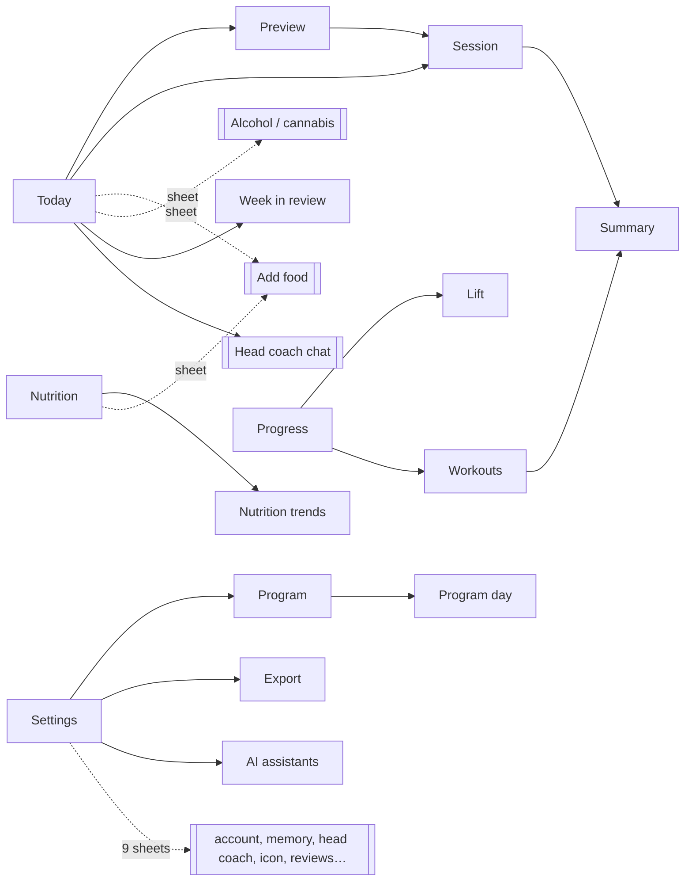

# UX audit: GymBuddy, 2026-11-28 (deep)

- **Commit:** `386921f` → see section 9
- **Platform / environments:** web (React/Vite PWA), Chromium via Playwright against the e2e fake backend, populated account (8 weeks of the 4-day split, weigh-ins, 10 days of food) plus a brand-new account. Core matrix: 390 dark, 390 light, 320 dark, 1280 dark, 200% zoom at 390. Deep matrix: 375, 430, 768, 1024, 1440, 1920, landscape 844×390, Focused view, 200% zoom at 320. Reduced motion on for every capture.
- **Reviewers:** ux-reviewer ✓ · interaction-reviewer ✓ · design-qa ✓ (see section 10). Accessibility, IA, trust and performance were reviewed by the main session.
- **Brief:** `docs/design/brief.md`, created in this run and marked **assumed** (adjectives not yet confirmed by Nick).

## 1. Executive verdict
The in-gym core (the Today hero card and the set card) is genuinely good. It's useful, fast and recognisably this app's. It failed the accessibility floor in ways that are cheap to fix: white text on the plate colours (2.3–3.4:1), grey captions under 4.5:1 in dark mode, pinch-zoom blocked on px-only text, and four layouts that break at 320px. Those are fixed in this pass. What's left is identity and IA: outside Today and the session, the screens drift into a generic dark tracker (violet accent, the lip on every card, glows), a new account can't find food logging, and the Workouts history doesn't scale. Those need Nick's call.

## 2. Coverage
| Item | Count |
|---|---:|
| Screens reviewed (route-level views) | 17 / 17 (Today, Preview, Session, Summary, Progress Trends, Progress Workouts, Lift, Nutrition Day, Nutrition Trends, Settings, Program list, Program day, Export, AI assistants, Coaches, Week in review*, OAuth consent*) |
| Modals and sheets reviewed | 7 / 39 overlay uses (Welcome, Add food, Coach chat, Rest alerts ask, Rest dock, Weigh-in, setup card); the rest by code only |
| Journeys run | 5 / 6 (J6 week in review not run: the review endpoint is faked empty) |
| Screenshots | 110 core + 198 deep before, 110 core after |
| Findings: P0 / P1 / P2 | 9 / 14 / 12 (see section 5) |
| WCAG failures | 8 (1.4.3 ×5, 1.4.4, 1.4.10 ×2) |

\* Week in review and OAuth consent were reviewed from code only.

**Inventory**
| Screen / route | Reached from | Job | Reviewed | Screenshots |
|---|---|---|---|---|
| Today `#/today` | launch, tab | pick today's workout, start it; calories left; this week | ✓ | `today__*`, `today-fresh__*` |
| Welcome sheet | first launch | pick a head coach | ✓ | `welcome__*` |
| Preview `#/preview/<day>` | Today hero card | look through the day's lifts | ✓ | `preview-push__*` |
| Session `#/session/<day>` | Start lifting | log sets, rest timer, finish | ✓ | `session-push__*`, `session-logged__*` |
| Summary `#/summary/<id>` | Finish, Workouts | recap, walkthrough, note | ✓ | `summary__*` |
| Progress `#/progress` | tab | which lifts are moving | ✓ | `progress__*` |
| Workouts `#/progress/workouts` | Progress segment | history, calendar, edit | ✓ | `progress-workouts__*` |
| Lift `#/lift/<name>` | Progress rows | one lift's chart and history | ✓ | `lift__*` |
| Nutrition `#/nutrition` | tab (food tracking on) | today's food vs targets | ✓ | `nutrition__*`, `nutrition-fresh__*` |
| Nutrition trends `#/nutrition/trends` | segment | weeks vs targets | ✓ | `nutrition-trends__*` |
| Add food sheet | meal Add, Today card | search / describe / repeat | ✓ | `add-food__*` |
| Settings `#/settings` | tab | everything else | ✓ | `settings__*` |
| Program `#/settings/program[/<day>]` | Settings | edit the split | ✓ | `program__*`, `program-push__*` |
| Export `#/settings/export` | Settings | CSV/JSON | ✓ | `export__*` |
| AI assistants `#/settings/ai` | Settings | connect Claude/ChatGPT | ✓ | `ai__*` |
| Coaches `#/coaches[/<id>]` | Today avatar | head coach chat | ✓ | `coaches__*`, `coach-*` |

**Sitemap**

Tabs: Today · Nutrition (only when food tracking is on) · Progress · Settings. Mental-model test passes for all four tabs. One gap: a new account has no Nutrition tab, and food tracking is a switch halfway down Settings (P-02).

## 3. Design identity
| Adjective (brief, assumed) | Evident / partly / absent | Evidence |
|---|---|---|
| Tough, not mean | Evident in copy, partly in art | "Excuses don't lift. You do."; "0 done · aim ~4" never shames. Tank's anger vein on Welcome leans mean. |
| Playful, not childish | Partly | Coaches and chunky shapes on Today, Session, Preview. Progress, Nutrition, Settings, Program, Export and AI are plain dark lists. |
| Glanceable, not sparse | Partly | Session's 155 / 10 and Today's hero are excellent. Lift names on Progress were truncated (fixed). Workouts history is 17,000pt long. |
| Honest, not preachy | Partly | "Filled dots set a new best" explains its chart; coaches change nothing without Apply. "usually undefined" leaked (fixed). |
| Bold, not loud | Partly | The Push hero is bold. A rainbow-rim chip, a full-bleed violet bodyweight card and six glowing PR rows on Progress are loud. |

**Logo-swap test:** Today, Preview and Session pass (plate hero, coach, lip). Progress, Nutrition, Trends, Settings, Program, Export and AI fail: any dark tracker with a violet accent could own them.
**Signature elements present:** the lip (everywhere, which dilutes it), plate-coloured day cards (Today, Session, Preview, Progress carousel), the coach crew (Session/Preview per lift; head coach elsewhere).
**Generic-AI tells found:** violet accent fills and a rainbow glow chip; glowing gold rims on every fresh-PR row; a heavy shadow/lip on nearly every surface in light theme.

## 4. Journey friction
See section 6 for the interaction run. Summary by journey:
| Journey | Step | Friction | Impact | Sev | Fix | Layer |
|---|---|---|---|---|---|---|
| J1 Log a workout | first rest | "Rest alerts" ask floats over the set card and the next Log set | must dismiss before logging the next set | P1 | fold the ask into the rest bar, or ask on the Summary | interaction (proposed, P-05) |
| J1 | rest at 320px | −15 sat on the countdown | can't read the timer | P0 | fixed (F-05) | presentation |
| J1 | Finish | Discard 24pt under Finish | one mis-tap from discarding (Undo exists) | P2 | fixed: more space (F-14) | presentation |
| J2 Log a meal | new account | no Nutrition tab; switch is in Settings | food logging undiscoverable | P1 | P-02 | structure |
| J3 Progress on a lift | Progress list | names truncated | can't tell which lift | P1 | fixed (F-09) | presentation |
| J4 First run | Today | two competing heroes (setup card + Push) | unclear first step | P1 | P-06 | structure |
| J5 Program | day editor | Swap/remove not visible on rows | recall over recognition | P2 | P-09 | structure |

Step counts (repeat user, from the interaction run): log one set = 1 tap; log a repeat meal = 2 taps (Add → Yesterday's dinner); start a workout from launch = 1 tap.

## 5. Findings (complete list)
| ID | Pri | Tag | Location | Problem | Fix | Effort | Status |
|---|---|---|---|---|---|---|---|
| F-01 | P0 | WCAG 1.4.4 | `index.html`, `src/main.jsx` | Pinch-zoom blocked; text is px and ignores iOS text size: no way to enlarge text | Allow pinch; keep double-tap off | S | fixed `f4eba2e` |
| F-02 | P0 | WCAG 1.4.3 | all plate fills (hero, Log set, Start lifting, set rings, lift carousel, rest-over) | White on Push 3.0, Pull 3.2, Shoulders 2.3, Custom 3.4, Day 7 ~3.3:1 | `--on-<day>` = Iron ink (5.4–7.5:1) | S | fixed `ced24b0` |
| F-03 | P0 | WCAG 1.4.3 | hero pills, Start lifting, Change, chart tips | Text in `--day-lip` on white: Legs 2.3, Shoulders 3.5, Push 4.4:1 | new `--<day>-deep` tokens (≥5.3:1) | S | fixed `ced24b0` |
| F-04 | P0 | WCAG 1.4.3 | grey captions, tab labels, Danger, bodyweight card | dark `--faint` 4.1/3.7, `--dock-mute` 4.4, light `--faint` 4.2 on surface-2, light `--danger` 4.2, white on `--accent` 4.2, translucent labels on plates 3.9–4.3 | tokens raised; `--accent-fill`; no translucent text on plates | S | fixed `ced24b0`, `7ec98cf` |
| F-05 | P0 | visual | Session rest bar @320 | "−15" overlapped the "2:30" countdown | tighter bar under 360px | S | fixed `ced24b0` |
| F-06 | P0 | WCAG 1.4.10 | Nutrition Trends stat tiles @320 | "10 of 10 days" chip ran out of its tile into the next | chip wraps inside the tile | S | fixed `ced24b0` |
| F-07 | P0 | WCAG 1.4.10 | Today weigh-in card @320/390 | Title one word per line ("Weigh- / in / due"), body 4–6 lines | field + Save wrap under the text | S | fixed `ced24b0` |
| F-08 | P1 | usability (trust) | Add food, `AddFood.jsx:286` | "10× · usually undefined · yesterday" for a meal id the app doesn't know | drop the clause when unknown | S | fixed `6c52fd5` |
| F-09 | P1 | usability | Progress list | "Lat Pulldown (W…", "Bulgarian Split Squ…": which lift? | names wrap to two lines | S | fixed `ced24b0` |
| F-10 | P2 | visual | Coach chat | disclaimer clipped to "AI can be wrong. Not medical" | max-height 5em | S | fixed `ced24b0` |
| F-11 | P1 | usability (Nick #5) | Lift header | bare pin icon: pinned, or pin this? | labelled Pin / Unpin pill | S | fixed `6c52fd5` |
| F-12 | P2 | usability | Nutrition Trends week rows | bare "−68" | "−68 vs goal" | S | fixed `6c52fd5` |
| F-13 | P2 | visual | Today @320 | greeting chip truncated to "Eveni…" | hidden under 360px (decorative) | S | fixed `ced24b0` |
| F-14 | P2 | usability | Session footer | Discard 24pt under Finish | 18px more space (Undo already exists) | S | fixed `ced24b0` |
| F-15 | P1 | identity (Nick #6) | every card, light theme most | the lip on nearly every surface; signature becomes noise | lip only on hero, primary/floating actions, tab bar, rest bar | M | proposed P-01 |
| F-16 | P1 | IA | new account | no Nutrition tab; food tracking is a Settings switch | always show Nutrition; empty state "Track food here. Turn on" | M | proposed P-02 |
| F-17 | P1 | usability | Workouts | every session fully expanded: 17,000pt for 8 weeks | one row per workout, grouped by week, tap to expand | M | proposed P-03 |
| F-18 | P1 | identity / brief | Nutrition macro bars | protein in Shoulders green, carbs in Legs yellow: breaks "plate = day only" | macro hues of their own, or neutral bars + labels | S | proposed P-04 |
| F-19 | P1 | usability | Session, first rest | Rest alerts ask floats over the set card | inline row in the rest bar, or ask on Summary | M | proposed P-05 |
| F-20 | P1 | usability | Today, new account | two heroes (glowing setup card + Push), "Push day" stated before any plan | one hero, quiet "Starter plan. Make it yours with Tank" | M | proposed P-06 |
| F-21 | P1 | performance / trust | app shell | 1.08 MB JS (323 kB gzip) in one chunk; service worker caches nothing, so a cold launch with no signal shows nothing | cache the app shell; split recharts/barcode/review | M | proposed P-07 |
| F-22 | P1 | identity | Progress, Nutrition, Settings | violet accent fills, rainbow-rim chip, gold glow on every fresh-PR row | one food hue; bodyweight on a neutral surface; PR stamp without rim on list rows | M | proposed P-08 |
| F-23 | P2 | usability | Program day | only reorder chevrons visible; swap/remove hidden | row menu with Swap and Remove | M | proposed P-09 |
| F-24 | P2 | usability | Session, Preview | status drawn as pills ("1 of 19 sets", "Try 155 × 10") in the same shape as buttons | status as plain text; pills for actions | M | proposed P-10 |
| F-25 | P2 | WCAG-adjacent | whole app | px type ignores iOS text size (pinch now works, but text doesn't scale with the setting) | rem type + `font: -apple-system-body` root | L | proposed P-11 |
| F-26 | P2 | identity | Welcome | Tank's anger vein reads "mean" on first impression | smirk as the default expression | S | open |
| F-27 | P2 | visual | Lift / Summary | "Est. max 95.3 lb" next to "82 lb": false precision | round e1RM to whole pounds in lists | S | open |
| F-28 | P2 | data robustness | Nutrition Day | food entries with an unknown meal id (e.g. written by another tool as "snack") count in totals but appear under no meal | map unknown meals to Snacks on load | S | open (logic) |

Interaction-run findings are merged in section 6.

## 6. Accessibility and interaction test results
- **Automated (capture metrics):** no horizontal overflow at 320–1920 in either theme, landscape or Focused view. Overflow at 200% zoom (195 CSS px) on 17/22 screens: beyond WCAG 1.4.10's 320px requirement, logged under P-11. Targets under 24px: Welcome's carousel dots (20×32, but swipe and arrow buttons exist), Progress carousel dots (22×22, arrows/swipe exist), the inline "Change" link (exempt, inline). 24–43px: ×-dismiss buttons already have 44px `::after` hit areas (false positive); "Show all sets" 40px; segment controls 40px; Ask buttons 40×50. Guideline misses only, P2.
- **Contrast:** every token pair re-measured with `contrast.py`; see F-02–F-04.
- **Keyboard / reduced motion:** see the interaction section below.

## 7. Performance
| Route / screen | Metric | Value | Threshold | Cause |
|---|---|---|---|---|
| all | main JS | 1,076 kB min / 323 kB gzip, one chunk | ~170 kB gzip for a fast cold start on 4G | recharts, AI SDK pieces, review, all views in one bundle |
| all | offline cold launch | nothing cached by the service worker | app shell should open offline | `public/sw.js` caches nothing by design |
| scanner | zxing WASM | 1.09 MB, lazy | fine | already split |

## 8. Needs your call (structure, IA, brand)
See the chat summary; each proposal P-01…P-11 maps to F-15…F-25 above.

- **P-01 Lip only where earned (F-15).** Recommend: keep it on the hero card, primary/floating buttons, tab bar and rest bar; flat with a hairline on list cards, stat tiles and secondary buttons. In dark (the default) the change is subtle; in light it calms every screen. Comparisons: `.ux-polish/redesign/lip/*-now.png` vs `*-proposed.png`. Cost: one selector list in `styles.css`. Alternative wins if the chunky everything-has-a-rim feel *is* the brand you want; then write it in the brief as an exception.
- **P-02 Always show Nutrition (F-16).** Recommend a 4-tab bar for everyone; with tracking off, Nutrition is an empty state with one "Turn on" action. Journey J2 goes from "find a switch in Settings" to 2 taps. Alternative wins if food is truly secondary for most users, in which case a quiet line on Today ("Tracking food too? Turn on") does the job.
- **P-03 Collapsed Workouts history (F-17).** One row per workout (day dot, sets, PR count), grouped by week, tap to expand. 8 weeks fits in about 3 screens instead of 45.
- **P-04 Macro colours off the plates (F-18).** Give protein/carbs/fat their own hues (or neutral bars with labels) so plate colours keep meaning "day".
- **P-05 Rest alerts ask in place (F-19).** Fold it into the rest bar as one row ("Lock-screen alert? Turn on"), or ask on the Summary after the first workout.
- **P-06 One hero for a new account (F-20).** Push stays the hero; the setup card becomes a quiet line inside it.
- **P-07 Cache the app shell (F-21).** Precache `index.html` + hashed assets in `sw.js`, network-first for the HTML; code-split recharts and the review. Directly serves "dead gym wifi never loses a workout".
- **P-08 Calm the accents (F-22).** One named food hue; bodyweight on a neutral surface with a violet line; PR stamp without the glowing rim on list rows (keep the rim for the Summary moment).
- **P-09 Program row menu (F-23).** **P-10 Status vs action shapes (F-24).** **P-11 Text that follows the phone's text size (F-25).**

## 9. Changes made
| Commit | Findings | Summary | Layer |
|---|---|---|---|
| `ced24b0` | F-02, F-03, F-04, F-05, F-06, F-07, F-09, F-10, F-13, F-14 | plate ink, deep tokens, grey tokens, accent-fill; narrow-width reflow; full lift names; chat note; discard spacing | presentation |
| `6c52fd5` | F-08, F-11, F-12 | unknown meal clause dropped; Pin/Unpin pill; "vs goal" | presentation |
| `f4eba2e` | F-01 | pinch-zoom allowed | interaction |
| `7ec98cf` | F-04 | no translucent text on plate/bodyweight cards | presentation |

## 10. QA result
_Filled in after design-qa._

## 11. Before / after
`.ux-polish/shots/2026-11-28/before/<screen>__<env>.png` vs `.ux-polish/shots/2026-11-28/after/<screen>__<env>.png` (same names).

## 12. Deferred, unverified, and needs real users
- Deferred: F-26, F-27, F-28 and all proposals.
- Not verified: real iOS Safari/standalone behaviour (pinch in standalone mode, lock-screen alerts, keyboard avoidance), VoiceOver, real network.
- Needs real users: whether people log food 3–5×/day for weeks; whether the week in review brings them back; whether the coach voice motivates or grates.
